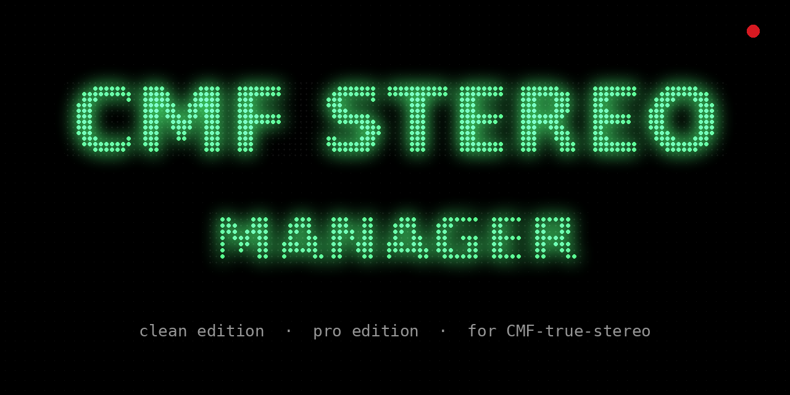

<p align="center"></p>

# CMF-true-stereo-manager

**The app for [CMF-true-stereo](https://github.com/Dr-Essence/CMF-true-stereo)**
— real left/right stereo on the CMF Phone 1, controlled without a terminal.

<p align="center">
  <a href="https://github.com/Dr-Essence/CMF-true-stereo-manager/releases/latest"><b>Download the app</b></a> ·
  <a href="https://github.com/Dr-Essence/CMF-true-stereo/releases/latest"><b>Get the module</b></a>
</p>

| | **CMF Stereo** | **CMF Stereo Pro** |
|---|---|---|
| Who it is for | everyone | tinkerers |
| What you get | on/off, Mono/Stereo, earpiece and speaker level 1–10 | everything, in raw values, plus developer tools |
| Look | Nothing style: black, NDot type in glowing green | Material dark |
| File | `CMF-true-stereo-clean-….apk` | `CMF-true-stereo-pro-….apk` |

Install either or both — they sit side by side. You need root and the
[module](https://github.com/Dr-Essence/CMF-true-stereo/releases/latest)
flashed first.

## Status

**Current release: v1.0.29** (both editions, about 1 MB each). Works best with module v0.9.3,
which adds the quick `status brief` the app asks for; older modules still work, just slower.

**Verified on the phone**
- CMF Stereo (clean): NDot 77 JP Extended loads from the phone, the glow and dot levels
  render, earpiece and speaker levels read correctly, and the title sits below the status bar.

**Not tested on a phone yet**
- v1.0.29: R8-shrunk release (clean 0.86 MB, pro 1.1 MB, built and checked locally),
  and the status read in a single root shell (its script checked against the module).
- CMF Stereo Pro's new dB earpiece slider and its Channels card.
- The Restart phone button in both editions.
- Either edition on a phone without NDot (should fall back to monospace).

**Pending**
- Release builds are signed with a temporary key, so an update needs the old app uninstalled
  first. A permanent signing key would fix that.

**Fixed recently**
- v1.0.29: the APK was 96.7 MB. Release builds were not shrunk, and they carried the whole
  Material extended icon set, which the app never uses. Both are fixed.
- v1.0.29: every refresh after a tap started about fourteen root shells, one per value,
  plus a full status that read every control back. Now it is one shell with `status brief`.
- v1.0.25: clean edition drew its title under the status bar (edge-to-edge on Android 15+).
- v1.0.21: earpiece slider treated 31 as the top; it is the codec's mute value.
- v1.0.21: two editions, Mono/Stereo channels, new names and links.

---

## About

A small root app for controlling the
[CMF-true-stereo](https://github.com/Dr-Essence/CMF-true-stereo) Magisk
module without a terminal.

The module works perfectly well on its own — this is the optional friendly
front end, in the same spirit as
[PerfMTK](https://github.com/JUANIMAN/PerfMTK) and its separate
[PerfMTK-Manager](https://github.com/JUANIMAN/PerfMTK-Manager).

## Two editions

Both are built from this repo and install side by side:

| | **CMF Stereo** (`clean`) | **CMF Stereo Pro** (`pro`) |
|---|---|---|
| For | everyday listening | tuning and diagnosing |
| Look | Nothing's design language: black, NDot type in glowing green | Material dark |
| Controls | on/off, Mono/Stereo, earpiece level and speaker level on a plain 1–10 scale | everything below, in raw values |
| Developer tools | none | mixer controls, diff, probe, sweep, logs, config files |

The clean edition uses Nothing's own NDot font from the phone (it prefers
the JP Extended cut, `Ndot77JPExtended.ttf` on the CMF Phone 1, then NDot 57,
then any NDot), so nothing of Nothing's
ships in the APK. Phones without it fall back to monospace.

Its levels map onto the module like this:

- **Earpiece level** 10 = `Handset Volume` 0 (+8 dB, the receiver's maximum),
  each step 2 dB down to level 1 (−10 dB).
- **Speaker level** (stereo only) 10 = `STEREO_ATTEN_DB` 6 dB, each step 2 dB
  more down to level 1 (24 dB). It never goes below the 6 dB margin that
  stands in for the speaker protection stereo turns off.

## What it does (Pro)

- **Channels: Mono / Stereo** — mono is stock audio (both drivers play the
  full mix, with Awinic speaker protection); stereo puts the left channel on
  the earpiece and the right on the speaker. Shows what is running and what
  is staged, warns before staging stereo, and offers a reboot when the two
  differ. In stereo, sets the amp attenuation that stands in for Awinic's
  protection (`STEREO_ATTEN_DB`). Needs module v0.9.0+; on older modules the
  switch is hidden. How and why: the module's README, *Mono and stereo*.
- Arm / disarm the earpiece output
- Earpiece gain slider in dB, −10 to +8 (`Handset Volume` 18 … 0; on this
  codec 0 is the loudest and 31 is mute — earlier versions had that the
  wrong way round)
- Mode: apply only while audio is playing, or always
- **Solo** — speaker off, earpiece only, for auditioning
- **Doctor** — diagnose why the earpiece is silent
- Log, probe and report, with output shown in the app

Everything it does is a call to the module's own `stereoctl`, or an edit to
`/data/adb/cmf-stereo/*.conf`. Nothing is duplicated — the module stays the
source of truth, and the terminal keeps working exactly as before.

## Requirements

- The `CMF-true-stereo` module, installed and rebooted ([Releases](https://github.com/Dr-Essence/CMF-true-stereo/releases))
- Root (Magisk / KernelSU / APatch) and superuser permission for this app
- Android 8.0+

## Not an Xposed module

There is nothing to hook. The settings are text files a shell daemon reads,
so this is an ordinary root app. It talks to `su` directly (commands go
over its stdin) rather than through a root library, to keep the dependency
list to Compose alone.

## Build

CI builds it on every push (`.github/workflows/build.yml`) and uploads the APK
as an artifact. Locally:

```sh
./gradlew assembleRelease
```

The release build is **debug-signed** so CI can produce an installable APK
without a secret key. Swap in a real signing config before publishing
anything you intend to update in place.

## Licence

© 2026 Dr.Essence, under the [0BSD licence](LICENSE): use, copy, change and
share it for any purpose, no conditions. The clean edition draws Nothing's
NDot font from the phone at runtime; no Nothing font ships in this app.
